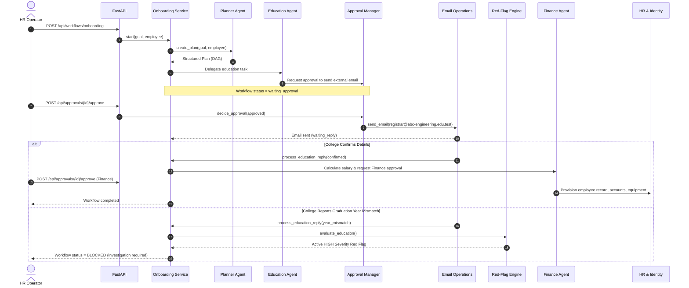

# System Architecture & Technical Specifications
## Enterprise Autonomous Onboarding & Verification System

---

## 1. High-Level Architecture Overview

```mermaid
flowchart TD
    User([Business Goal / HR Operator]) -->|POST /api/workflows/onboarding| API[FastAPI Layer]
    API --> Service[Onboarding Service & Orchestrator]

    subgraph Intelligence & Planning Layer
        Service --> Planner[Planner / Orchestrator Agent]
        Planner --> LLM[Resilient LLM Provider]
        LLM --> Gemini[Google Gemini 3.8 Flash]
        LLM --> Groq[Groq LPU]
        LLM --> Offline[Deterministic Offline Adapter]
    end

    subgraph Multi-Agent Dispatcher & Event Bus
        Service --> Dispatcher[Agent Dispatcher]
        Dispatcher <--> DocAgent[Document Agent]
        Dispatcher <--> EduAgent[Education Verification Agent]
        Dispatcher <--> EmpAgent[Employment Verification Agent]
        Dispatcher <--> EmailAgent[Email Operations Agent]
        Dispatcher <--> FinAgent[Finance / Salary Agent]
        Dispatcher <--> HRAgent[HR Agent]
        Dispatcher <--> AccAgent[Account & Access Agent]
        Dispatcher <--> EquipAgent[Equipment Agent]
        Dispatcher <--> CompAgent[Compliance Agent]
        Dispatcher <--> CommAgent[Communication Agent]
    end

    subgraph Governance & Safety Gates
        Service --> HITL[Human Approval Manager]
        Service --> RedFlags[Red-Flag Detection Engine]
        Service --> Recovery[Recovery & Resilience Manager]
        Service --> SalaryEngine[Deterministic Salary Engine]
    end

    subgraph Authorized Execution & Simulators
        DocAgent & EduAgent & FinAgent & HRAgent & AccAgent & EquipAgent & CompAgent --> Registry[Tool Registry]
        Registry --> Simulators[Enterprise Simulators: HRIS, Identity, Equipment, Documents, Mail]
    end

    subgraph Durable Persistence & Tamper-Evident State
        Service --> DB[(SQLite Source of Truth)]
        DB --> WfTable[workflows & tasks]
        DB --> EmpTable[employees]
        DB --> ApprTable[approvals]
        DB --> FlagTable[red_flags]
        DB --> MailTable[email_messages & threads]
        DB --> AuditTable[audit_events: SHA-256 Hash Chained]
    end
```

---

## 2. Core Architectural Principles

### 2.1 Separation of Evidence vs. Authority
- Documents uploaded by candidates and emails received from external addresses are strictly treated as **untrusted evidence**.
- LLMs are used for extraction, classification, and summarization, but **never possess authority** to change workflow states, grant access, or finalize compensation without deterministic validation and explicit human approval.

### 2.2 Strict Pre-Execution Human Approval Gates
- The Human-in-the-Loop (HITL) gatekeeper stops execution *before* an authorized tool executes.
- Every approval request is cryptographically bound to the exact action payload using a parameter fingerprint (`sha256(repr(sorted(payload.items())))`). If parameters are modified after approval, the tool execution is immediately rejected.

### 2.3 100% Deterministic Compensation Engine
- Salary math is never delegated to LLM generative output.
- All compensation components (Basic, HRA, Special Allowance, Employer PF, Employee PF, Deductions, Monthly Gross, Estimated Net) are calculated via [`SalaryCalculationEngine`](file:///d:/TIER1/AI/AI_FINAL/MIT_AI_MultiAgentSys/app/core/salary.py) with exact mathematical reconciliation against approved CTC.

### 2.4 Tamper-Evident Hash-Chained Audit Trail
- Every workflow event is recorded into SQLite with an append-only contract.
- Each audit event includes a SHA-256 hash of its payload concatenated with the previous event's hash (`previous_hash -> hash`), creating a tamper-evident blockchain-like log for SOC-2 and compliance audits.

---

## 3. Data Flow: Typical Onboarding Lifecycle

---

## 4. Database Schema Specifications

The SQLite database (`enterprise_onboarding.db`) manages persistent relational tables:
- `workflows`: Stores workflow ID, goal, employee profile snapshot, full DAG plan JSON, status, and timestamps.
- `tasks`: Individual atomic task statuses, agent assignments, dependency JSON arrays, results, and errors.
- `employees`: Unique employee records, department, designation, and metadata.
- `approvals`: Approval IDs, associated workflow & task, requested action, payload JSON, payload fingerprint, decision, reviewer, and review comments.
- `red_flags`: Flag IDs, category, severity (`CRITICAL`, `HIGH`, `MEDIUM`, `LOW`), evidence JSON, detection method, and resolution audit.
- `verifications`: Academic and previous-employment verification records, tracking sent message IDs and reply statuses.
- `salary_profiles`: Approved salary structures, CTC components, tax assumptions, and finance sign-offs.
- `email_messages`: Complete email history (inbound and outbound) with thread correlation IDs and status tracking.
- `agent_messages`: Inter-agent communication logs with correlation IDs (`CORR-...`).
- `recovery_records`: Retry attempt counters, error classifications, and fallback actions.
- `audit_events`: Tamper-evident append-only event trail with `previous_hash` and `hash`.

